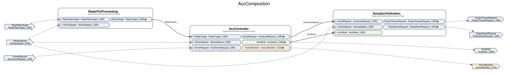

# ACC system example

Adaptive Cruise Control (ACC) subsystem modeled with the template/factory idiom described in
[../README.md](../README.md). Applying the composition template alone creates the entire project:

```python
workspace = ar_workspace.Workspace("acc_config.toml", document_root="generated/schema_51")
workspace.apply(component.AccComposition)
workspace.write_documents(schema_version=51)
```

## Architecture



| Component | Cycle | Role |
|---|---|---|
| `RadarPreProcessing` | 40 ms | Filters raw radar detections, publishes one tracked target |
| `AccController` | 20 ms | Speed/distance control law, ACC state machine, calibration service |
| `ActuatorArbitration` | 10 ms | Splits acceleration request into engine torque and brake deceleration |

## Signals

Application data types carry physical semantics; implementation data types carry the platform
representation. The conversion used by every linear compu-method is

```text
physical_value = offset + factor * internal_value
```

| Type | Base type | Resolution | Physical range | Unit |
|---|---|---|---|---|
| `VehicleSpeed_T` | uint16 | 1/64 | 0 .. 1023.984375 | km/h |
| `SetSpeed_T` | uint8 | 1 | 0 .. 255 | km/h |
| `TargetDistance_T` | uint16 | 0.05 | 0 .. 250 | m |
| `RelativeSpeed_T` | sint16 | 0.01 | -128 .. 128 | m/s |
| `LongitudinalAccel_T` | sint16 | 0.001 | -10 .. 5 | m/s² |
| `TorqueRequest_T` | sint16 | 0.5 | -1000 .. 1000 | Nm |
| `TimeGap_T` | uint8 | 0.1 | 0.8 .. 2.5 | s |
| `RadarTargetValid_T` | uint8 | text table | NotValid, Valid | - |
| `AccMode_T` | uint8 | text table | Off, Standby, Active, Override | - |

Port interfaces: sender-receiver interfaces for the radar, vehicle-dynamics, driver-request,
acceleration, torque and brake signals; a `AccMode` mode-switch interface backed by the
`AccMode` mode declaration group (`OFF`, `STANDBY`, `ACTIVE`, `OVERRIDE`); and the
`AccCalibration_I` client-server interface (`ReadParameter`, `WriteParameter` with the
application errors `E_NOT_OK` and `E_OUT_OF_RANGE`).

## Scripts

Run from the repository root (also wired into `run_examples.sh`):

```bash
python examples/template/generate_acc_xml.py       # ARXML for schema 48, 49, 50 and 51
python examples/template/verify_acc_roundtrip.py   # reader/writer round-trip check
python examples/template/generate_acc_diagram.py   # diagram derived from the workspace model
```

Generated ARXML is written to `generated/schema_<version>/`, the diagram to `diagram/`.
The diagram generator emits Graphviz DOT from the composition in the workspace and renders it
with the `dot` executable when available (SVG and PNG); without Graphviz the DOT file is still
written.
